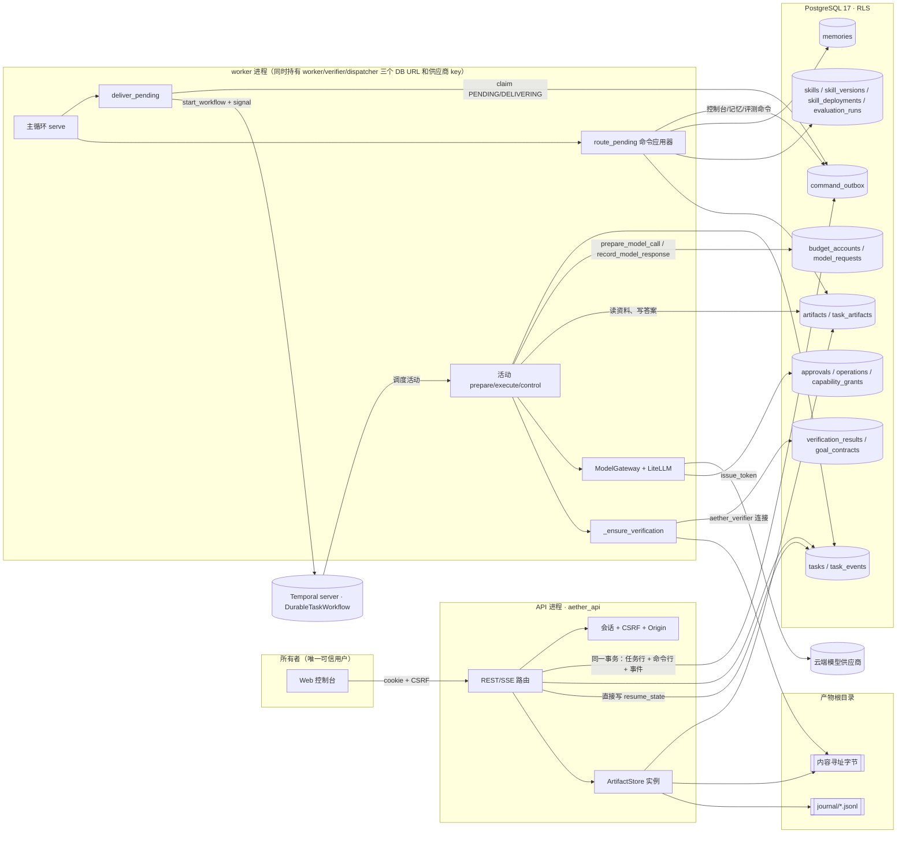
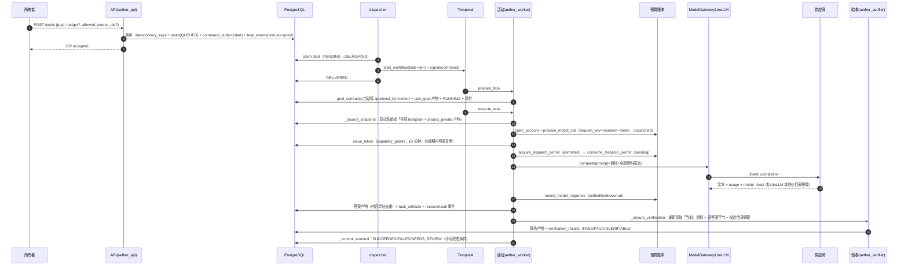
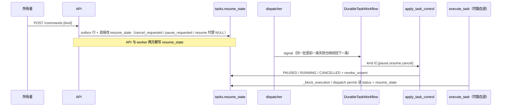
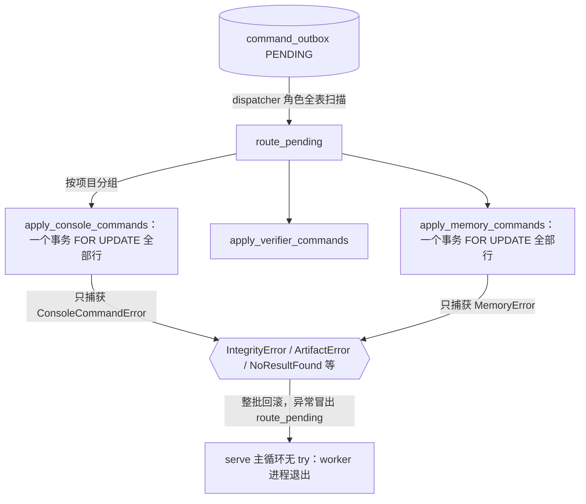

# 全链路地图（基线 `d6ed382`）

本图按代码实际调用关系画，不按规格里的目标拓扑画。凡是「规格有、产品路径没接上」的组件单独标出，避免把库函数和测试里的能力当成上线能力。

## 1. 组件清单

| 组件 | 代码位置 | 运行在哪 | 数据库角色 | 是否在产品路径上 |
|---|---|---|---|---|
| Web 控制台 | `apps/web/app/*` | Next.js（浏览器） | 无 | 是（只读展示 + 调 REST） |
| REST API / SSE | `services/api/aether_api/app.py`、`control.py`、`console_routes.py`、`memory_routes.py`、`auth_service.py` | `python -m aether_api.main`（uvicorn） | `aether_api` | 是 |
| 命令发件箱 | 表 `command_outbox`；写入 `services/worker/aether_worker/outbox.py`、`memory_routes._enqueue` | API 事务内 | `aether_api` 写，`aether_dispatcher` 读/改状态 | 是 |
| 投递器 dispatcher | `services/worker/aether_worker/dispatcher.py` | worker 进程主循环（`service.serve`） | `aether_dispatcher` | 是（只投递 start/approve_goal/pause/resume/cancel） |
| 非 Temporal 命令应用器 | `service.route_pending` → `console_commands.apply_console_commands` / `apply_verifier_commands`、`memory.apply_memory_commands` | worker 进程主循环（control 线程池） | `aether_worker` / `aether_verifier` | 是 |
| Temporal 工作流 | `durable_workflow.DurableTaskWorkflow` | Temporal server + worker 进程内的 `Worker` | 无（工作流不做 I/O） | 是 |
| 活动 prepare / execute / control | `goal_effect.prepare_task_effect`、`execute_task_effect`、`apply_task_control_effect` | worker 进程，activity 线程池 | `aether_worker` | 是 |
| 模型网关 | `services/gateway/aether_gateway/model.py`（`ModelGateway`） | **worker 进程内**（不是独立进程） | `aether_worker`（令牌表） | 是（live 研究） |
| LiteLLM | `litellm.completion`（`openai/<alias>` + `api_base`） | worker 进程内 | — | 是 |
| 预算与调用账本 | `packages/storage/aether_storage/budget.py` | worker 进程内 | `aether_worker` | 是 |
| 产物存储 | `packages/storage/aether_storage/artifacts.py`（内容寻址 + 日志） | API 进程和 worker 进程各自实例化 | `aether_api` / `aether_worker` / `aether_verifier` | 是 |
| 目标验收器 | `goal_effect._ensure_verification` + `research.goal_completion_*` + `research.record_verification` | **worker 进程内**，换用 `aether_verifier` 连接 | `aether_verifier` | 是 |
| 记忆 | `services/worker/aether_worker/memory.py` | worker 进程（命令应用器） | `aether_worker` | 是（增/改/删） |
| 技能库与晋升 | `console_commands._skill_import/_skill_deploy/_rollback`、`skill_eval.py`、`skills.py` | worker 进程 | `aether_worker` / `aether_verifier` | 导入、晋升命令在；评测执行、回滚实际不可达（见 P2-04） |
| 操作账本 / 审批 | `packages/storage/aether_storage/operations.py` | API 只调用 `decide` | `aether_api` / `aether_worker` | 只有审批决定接上；`dispatch/reconcile` 没有产品调用方 |
| 工具注册表 / MCP | `aether_gateway/registry.py`、`mcp_client.py` | — | — | **否**，只在测试和 `security_regression.py` 中调用 |
| 采集 / 检索 / 推荐 | `ingest.py`、`retrieval.py`、`recommendations.py` | — | — | 采集任务只建行不执行；`POST /search` 固定 503；推荐 GET 会写画像和曝光 |
| 编码执行器 runner | `runner.py`（`LinuxRunner`） | — | — | **否**；`coding.create` 只写 `coding_jobs` 行 |
| 代码评分器 grader | `verification.grade` | Docker 容器 | `aether_verifier`（`record_grade`） | **否**，只在测试中调用 |
| 技能脚本沙箱 | `skills.execute_script` | Docker 容器 | — | **否**，只在测试中调用 |
| CodeGraph | `codegraph_adapter.py` | Docker 容器（`--network none`） | — | 选配；`config/codegraph.lock.json` 已 `product_enabled: true`（ADR-CG2），但只有 `scripts/run_codegraph_product.py` 和测试调用，研究任务主路径不使用 |
| 跟踪 watches | `watches.py`（Temporal Schedule） | — | — | 建/改/删命令在；激活只有库函数 `enable_watch`，API 无入口 |
| 备份/恢复 | `supply.py` | 运维脚本 | 管理员连接 | 运维路径 |
| 建库/迁移 | `aether_storage/bootstrap.py`、`migrations/versions/*` | 运维脚本 | 管理员连接 | 两条路径并存（见 P1-08） |

## 2. 总体数据流



## 3. 研究任务主链路



关键事实：
- 工作流从不收到 `close`，任务工作流永久开着（`durable_workflow.py:73`）；活动都是 `start_to_close_timeout=60s`、默认无限重试、没有 heartbeat 超时（`durable_workflow.py:62,82,86,110,120`）。
- 默认来源发现会把**所有** `text/plain + project_private` 产物当资料（`goal_effect.py:779-787`），包括记忆的 claim 产物（`memory.py:298,338`）。
- 验收器在答案写完之后重新跑 `_source_snapshot`（`goal_effect.py:574`），不读模型请求里记下的快照。

## 4. 控制命令（暂停 / 恢复 / 取消）



## 5. 非 Temporal 命令



## 6. 存储布局与权威归属

| 状态 | 规格里的权威 | 代码里的实际写入方 | 观察 |
|---|---|---|---|
| 执行进度 | Temporal 历史 | 工作流 + `tasks.status` 投影 | 工作流永不结束；终态不写事件（P2-02） |
| 控制意图 | 命令 + 工作流 | API 写 `resume_state`，worker 也写 | 双写，恢复会抹掉取消请求（P1-03） |
| 合同 | `goal_contracts`（不可变） | worker 自动插入并写 `approved_by=owner`；API 的 `draft_contract` 是另一份、可随时改 | 公开视图显示 `draft_contract` 的哈希（P2-02） |
| 预算/调用 | `budget_accounts` + `model_requests` | worker | 网关本身不碰账本（P2-05） |
| 产物字节 | ArtifactStore | API、worker、verifier | 一个 `storage_key` 只能有一行，tombstone 永久占用（P1-01） |
| 任务↔产物 | `task_artifacts` | worker | 首次引用仍写 `artifacts.task_id`（`goal_effect.py:493-500`） |
| 验收证据 | `verification_results`（verifier 角色） | worker 进程用 verifier 连接写 | 凭证与 worker 同进程（P2-09） |
| 记忆 | `memories` | worker | claim 同时写成 project_private 产物（P0-01） |

产物根目录：`<root>/<project>/<sha[:2]>/<sha>`（字节）、`journal/<project>.jsonl`（准备/提交日志）、`snapshots/`、`snapshot-meta/`、`quarantine/`、`journal-repair/`、`journal-quarantine/`。`ArtifactStore.recover()` 没有任何产品调用方。

## 7. 信任边界

```mermaid
flowchart TB
  subgraph Trusted["可信控制面"]
    OWNER[所有者会话<br/>loopback + cookie + CSRF + Origin]
    APIC[API 代码 / aether_api 角色]
    WRK[worker 代码 / aether_worker 角色]
    VRF[验收代码 / aether_verifier 角色]
    DSP[dispatcher / aether_dispatcher 角色]
    KEY[(供应商 key<br/>AETHER_LIVE_MODEL_KEY)]
  end
  subgraph Untrusted["不可信输入"]
    UP[上传文件]
    MEMC[记忆 claim 文本]
    OUT[模型输出]
    META[供应商回报的 usage / model 名 / 费用]
    SK[技能包]
    CAND[编码候选代码]
    WEB[网页 / RSS（未接产品路径）]
    MCPD[MCP 工具描述与返回（未接产品路径）]
  end
  UP -->|原文进入提示词与验收资料| WRK
  MEMC -->|作为 project_private 产物进入提示词与验收资料| WRK
  OUT -->|写成答案产物，交给验收| VRF
  META -->|决定 settled/held/overrun 和"已知花费"| WRK
  SK -->|导入后 QUARANTINED| WRK
  CAND -->|评分器子进程内 import| VRF
  KEY --- WRK
  VRF -. 同一进程 .- WRK
```

凭证分布：

| 进程 | 持有 |
|---|---|
| API | `aether_api` 连接串、`secrets/bootstrap.json` 引导口令文件 |
| worker | `aether_worker`、`aether_verifier`、`aether_dispatcher` 三个连接串，供应商 key，Temporal 地址，Docker 控制权（技能脚本、评分器、runner 调用 `docker` 命令） |
| 评分容器 / 技能容器 | 无 DB、无 key、`--network none`（基线用例证实） |
| 运维脚本 | 管理员连接串（`ensure_database`、备份/恢复） |

与规格的差异：规格要求网关、runner-manager、verifier「分开进程/凭证」（`docs/02_architecture.md` §1、§7），代码里三者都在 worker 进程内；Docker 控制权也在 worker 进程。目前 actor（模型）不执行代码，所以这不是已被利用的越权路径，但信任边界只靠代码约定。

## 8. RLS 与角色（本轮实测）

- 所有业务表开启 `FORCE ROW LEVEL SECURITY`，策略按 `aether.project_id` 事务级设置过滤；API 角色另加 `RESTRICTIVE` 的 owner 可见性策略（`migrations/sql/0002_privileges.sql`）。
- 对照用例证实：未设置项目时 worker 角色看不到任务；API 角色不能插入 `verification_results`、不能把任务推进到 SUCCEEDED；跨项目的 `allowed_source_ids` 在调用前就被拒（`repro/test_c00_controls.py`，3 项通过）。
- dispatcher 角色可读所有项目的 PENDING/DELIVERING 命令（含目标原文与 owner_id），这是设计如此。
- 数据库终态守卫只拦「终态 → 可调度状态」，不拦「终态 → 另一个终态 / NEEDS_REVIEW」（P2-06）。
